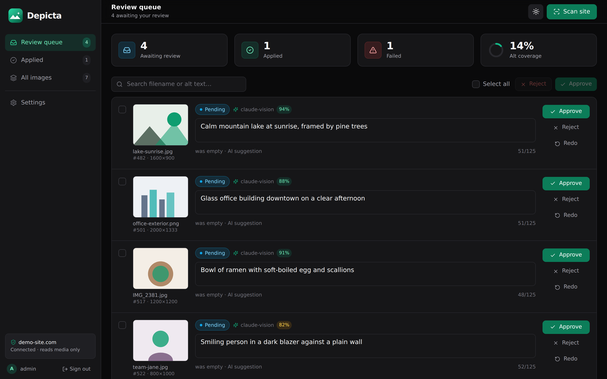
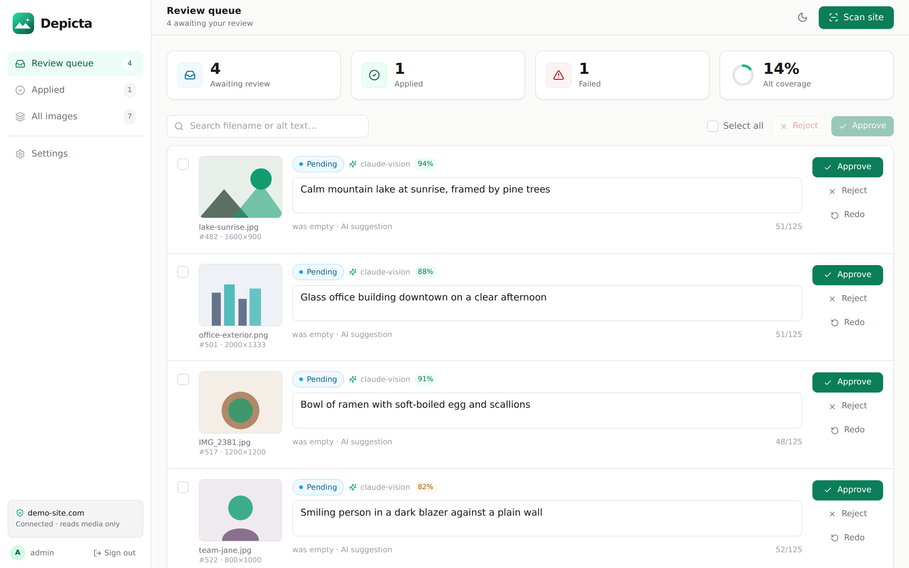
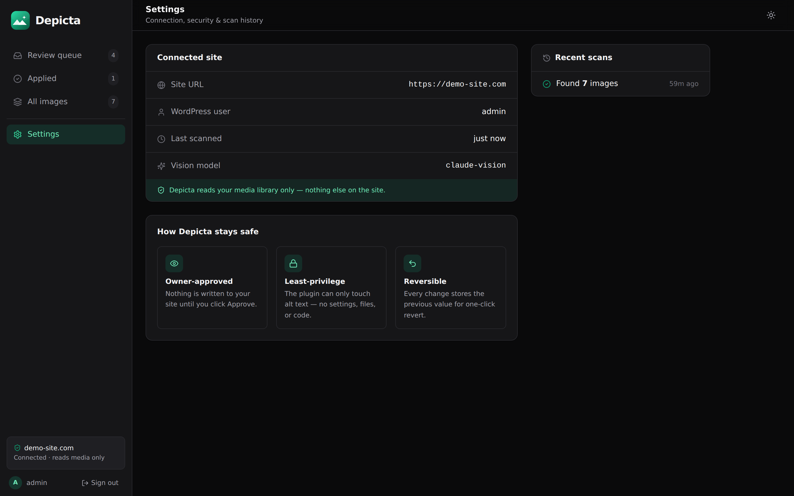

# Depicta

**AI-generated alt text for WordPress — human-in-the-loop and security-first.**

Depicta scans a WordPress media library for images missing alt text, drafts a concise,
WCAG-compliant description for each with a Vision model, and writes it back **only after the
site owner approves it** — with every change fully reversible.

[](https://github.com/aulon10/depicta/actions/workflows/ci.yml)
[](LICENSE)
[](https://dotnet.microsoft.com/)
[](https://react.dev/)

**Live:** app → [depicta-1.onrender.com](https://depicta-1.onrender.com) · API → [depicta.onrender.com](https://depicta.onrender.com)

> The free hosting tier sleeps after inactivity, so the first request may take ~30–60s to wake.

---

## Why it exists

An AI that can write to your live site only works if you can trust it. Depicta is built around
one rule: **the tool never changes a site on its own.** It can do exactly two things to a
WordPress site — read images that are missing alt text, and set alt text on a single image the
owner has explicitly approved. Nothing else.

## Screenshots

| Review queue (dark) | Review queue (light) |
|---|---|
|  |  |

| Settings — connection, security & scan history |
|---|
|  |

## How it works

```
Scan WordPress  →  AI drafts alt text  →  Owner reviews & edits  →  Approve  →  Written to WP  →  1-click revert
   (plugin)          (background worker)        (React UI)                       (signed call)
```

Every image moves through an enforced **state machine** — it can never reach *Applied* (a write
to the live site) without passing through *Approved*.

## Key features

- **Human-in-the-loop:** nothing is written until you click Approve; inline editing with a live
  125-character WCAG counter.
- **Reversible:** every change stores the previous value for one-click revert.
- **Least-privilege WordPress plugin:** two REST routes, scoped to attachment alt text only.
- **Provider-abstracted Vision:** Claude Vision by default, swappable behind `IVisionProvider`.
- **Image right-sizing:** large/AVIF/HEIC images are resized and re-encoded before upload to cut
  tokens and cost.
- **Resilient worker:** transient failures retry with exponential backoff; one bad image never
  blocks the batch.
- **Polished UI:** dark/light themes, responsive, coverage ring, skeleton loading.

## Security (the differentiator)

- **JWT admin auth** on every endpoint (a fallback policy means no controller can forget it);
  passwords hashed with PBKDF2-HMAC-SHA256.
- **HMAC-signed WordPress calls** — the shared secret never travels the wire; a timestamp + a
  one-time nonce make a captured request useless to replay.
- **Credentials encrypted at rest** (ASP.NET Data Protection).
- **Rate limiting**, security headers, HTTPS/HSTS, and an explicit CORS allow-list.
- **Secrets out of code** — signing key, admin hash and API key come from the environment.

## Tech stack

| Layer | Tech |
|---|---|
| Backend | .NET 8, ASP.NET Core Web API, EF Core 8 |
| Database | PostgreSQL (prod) · SQLite (local dev) |
| Frontend | React 18, TypeScript, Vite, Tailwind CSS |
| WordPress | PHP companion plugin (2 REST routes) |
| Vision | Anthropic Claude (provider-abstracted) |
| Tests/CI | xUnit (unit + integration) · GitHub Actions |
| Deploy | Docker · Render · Neon |

## Tests & CI

47 tests (xUnit) cover the core logic — the approval state machine, the alt-text sanitizer, the
PBKDF2 hasher, the HMAC request signer — plus API integration tests that boot the real app and
verify the auth boundary. GitHub Actions runs `dotnet test` and `npm run build` on every push.

```bash
cd backend
dotnet test
```

## Run locally

**Backend** (SQLite, zero-setup):
```bash
cd backend/Depicta.Api
dotnet user-secrets set "Vision:Claude:ApiKey" "sk-ant-..."
dotnet run          # http://localhost:5080  · Swagger at /swagger
```

**Frontend:**
```bash
cd frontend
npm install
npm run dev         # http://localhost:5173
```

Dev admin login: `admin` / `depicta-dev-2026`. Full backend, WordPress and deployment docs live
in [`backend/README.md`](backend/README.md) and [`docs/`](docs/).

## Deployment

Everything is containerized (`docker-compose.yml`) and deployed as: a Docker web service (API) +
static site (frontend) on Render, with PostgreSQL on Neon. See
[`backend/README.md`](backend/README.md) → *Deployment*.

## Roadmap

- [x] Core pipeline: scan → AI → review → approve → apply → revert
- [x] Security hardening (auth, HMAC signing, encryption, rate limiting)
- [x] Data & reliability (PostgreSQL + migrations, image resizing, worker retries)
- [x] Testing + CI (xUnit, GitHub Actions)
- [x] Docker + live deployment
- [x] Monitoring, alerts, error tracking & dependency scanning
- [ ] In-app "connect site" flow for production
- [ ] Multi-tenant (SaaS)

## License

MIT — see [LICENSE](LICENSE).

Built by [Aulon Murtezi](https://github.com/aulon10).
