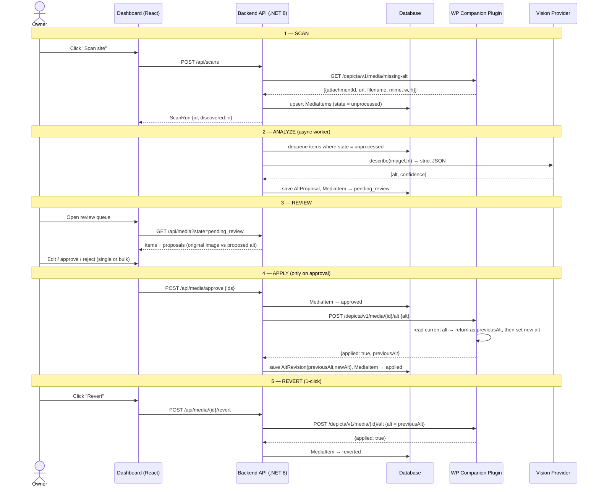
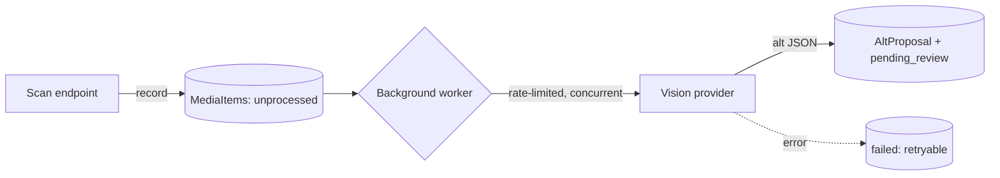

# Depicta — Phase 1: System Architecture & Data Flow

> Depicta finds WordPress images that are missing alt text, drafts a WCAG-compliant
> description for each with a Vision model, and writes it back **only after the site
> owner approves it** — with every change reversible.

**v1 scope:** single site. One dashboard is connected to one WordPress site. The data
model already carries a `Site` row so multi-tenant is a later migration, not a rewrite.

---

## 1. Components & responsibilities

Three moving parts, each with a deliberately narrow job. The security posture comes from
keeping the WordPress-facing surface as small as possible and never letting the backend
mutate a site without an explicit, owner-approved action.

| Component | Tech | Responsibility | Can it write to WP? |
|-----------|------|----------------|---------------------|
| **Companion plugin** | PHP (WordPress) | Exposes 2 narrow REST routes: *list media missing alt* and *set alt for one attachment* (capturing the previous value). Nothing else. | Only alt metadata (`_wp_attachment_image_alt`), one attachment per call |
| **Backend API** | .NET 8 | Orchestration: scan, queue, call Vision AI, hold proposals, drive the state machine, call the plugin on approval. Owns the database. | No — it can only ask the plugin, and only for an approved item |
| **Dashboard** | React + Tailwind | Human-in-the-loop UI: side-by-side review, edit, bulk approve/reject, revert. | No — talks to Backend API only |
| **Vision provider** | Claude Vision (default), abstracted | Turns an image into a concise, WCAG-compliant alt string. | — |

### Why the backend is deliberately "weak"
The backend never has standing power to change a site. It can only invoke the plugin's
`set-alt` route, and only as the direct result of a user clicking **Approve**. If the
backend were ever compromised, the blast radius is "alt text on connected sites" — not
arbitrary site modification. This is the single most important security decision in v1.

---

## 2. Authentication (single-site)

- The owner creates a **WordPress Application Password** for a dedicated `depicta` user
  (or their admin user) and pastes it once into the dashboard.
- The backend stores it **encrypted at rest** (ASP.NET Data Protection / a KMS in prod),
  scoped to the one `Site` row, and uses it as HTTP Basic auth **over HTTPS only** when
  calling the plugin's REST routes.
- The plugin additionally checks `current_user_can('upload_files')` and verifies a
  per-site shared secret header, so a leaked app password alone is not enough to hit the
  Depicta routes.
- The credential is **revocable**: deleting it in WP or in the dashboard immediately cuts
  access. Nothing is ever logged in plaintext.

---

## 3. End-to-end data flow

---

## 4. Async processing model

Scanning can discover hundreds of images; Vision calls are rate-limited and cost money, so
analysis is decoupled from the HTTP request:

- The scan endpoint only **records** items (`unprocessed`) and returns fast.
- A hosted background worker (`IHostedService` + a bounded `Channel<Guid>`) drains items,
  calls the Vision provider with **retry + backoff**, respects a configurable
  **concurrency limit and per-minute rate cap**, and moves each to `pending_review`.
- Failures move an item to `failed` with an error reason (retryable from the UI), never
  silently dropped.

---

## 5. Trust boundaries (what crosses where)

- **Dashboard ↔ Backend:** the owner's session. No WP secrets ever reach the browser.
- **Backend ↔ WP plugin:** app password + shared secret, HTTPS. Only two routes exist.
- **Backend ↔ Vision:** image URL (or bytes) out, alt string in. No site credentials.
- **Data minimization:** Depicta stores image URLs, metadata, and alt strings — never post
  content, users, or anything outside the media library.

See `02-data-model-and-api.md` for the database schema, the MediaItem state machine, and
the full REST contracts for both the Backend API and the WordPress plugin.
