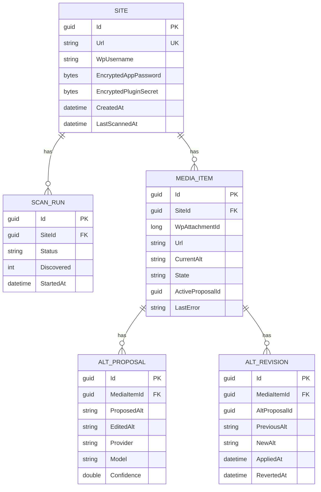
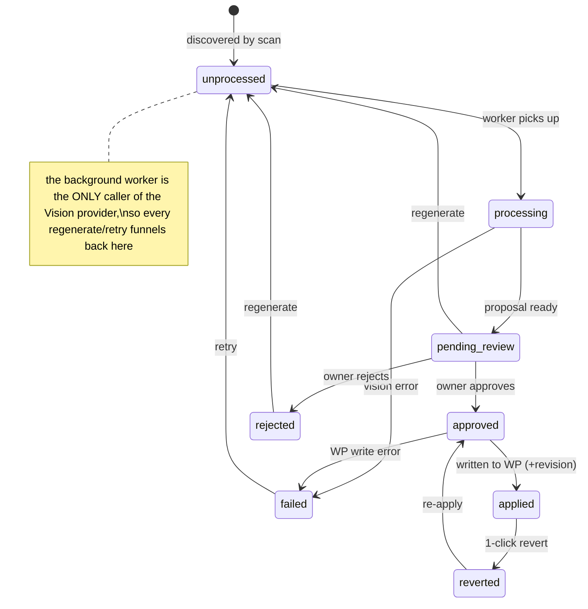

# Depicta — Phase 2: Data Model & REST API Spec

Covers the database schema, the MediaItem **state machine**, and the endpoint contracts for
both the **Backend API** and the **WordPress companion plugin**. Backend stack: **.NET 8 +
EF Core**. Scope: **single site** (`Site` is one row, but every table already carries
`SiteId`).

---

## 1. Entity–relationship overview



Key constraints (see `DepictaDbContext.cs`):
- `MEDIA_ITEM (SiteId, WpAttachmentId)` **unique** — a scan upserts on this key.
- `MEDIA_ITEM (SiteId, State)` **indexed** — the review queue and worker both filter by state.
- Enums stored as **strings** (readable in the DB, order-independent).
- `EncryptedAppPassword` / `EncryptedPluginSecret` are ciphertext; never serialized to any API.

---

## 2. MediaItem state machine

The whole product is enforced here. Transitions live in `MediaItemStateMachine.cs`; an
illegal move throws, so an image can never reach `applied` without passing through the
owner's `approved`.



| State | Meaning | Wrote to WP? |
|-------|---------|--------------|
| `unprocessed` | Found by scan, no proposal yet | No |
| `processing` | Vision call in flight | No |
| `pending_review` | Proposal awaiting owner | No |
| `approved` | Owner OK'd, write queued | No (yet) |
| `applied` | Alt written to WordPress | **Yes** |
| `rejected` | Proposal declined | No |
| `reverted` | Applied value rolled back | Yes (restored previous) |
| `failed` | Vision/WP error, retryable | No |

---

## 3. Backend API contract

Base: `/api`. Auth: the dashboard's own session (owner). JSON throughout. Secrets are
write-only — no endpoint ever returns the app password or plugin secret.

| Method | Path | Purpose | Body → Response |
|--------|------|---------|-----------------|
| `PUT` | `/api/site` | Connect the WordPress site (encrypts + stores creds) | `ConnectSiteRequest` → `SiteDto` |
| `GET` | `/api/site` | Get connected site (no secrets) | — → `SiteDto` / 404 |
| `DELETE` | `/api/site` | Disconnect and wipe credentials | — → 204 |
| `POST` | `/api/scans` | Start a scan (async); returns fast | — → `202 ScanRunDto` |
| `GET` | `/api/scans?take=` | Recent scan runs | — → `ScanRunDto[]` |
| `GET` | `/api/scans/{id}` | One scan run | — → `ScanRunDto` |
| `GET` | `/api/media?state=&page=&pageSize=` | Review queue (default `pending_review`) | — → `PagedResult<MediaItemDto>` |
| `GET` | `/api/media/{id}` | One item + active proposal | — → `MediaItemDto` |
| `POST` | `/api/media/approve` | **Approve → write to WP** (bulk, per-item edit) | `ApproveRequest` → `BulkActionResult` |
| `POST` | `/api/media/reject` | Reject proposals (no write) | `RejectRequest` → `BulkActionResult` |
| `POST` | `/api/media/regenerate` | Re-queue for a fresh proposal | `RegenerateRequest` → `BulkActionResult` |
| `POST` | `/api/media/{id}/revert` | 1-click revert to previous alt | — → `MediaItemDto` / 409 |

### Example — approve (bulk, with an edit)
```jsonc
// POST /api/media/approve
{
  "items": [
    { "mediaItemId": "6f9…", "editedAlt": "Team standing outside the new office" },
    { "mediaItemId": "8a2…" }                      // approve the AI text as-is
  ]
}
// 200 OK
{
  "succeeded": ["6f9…", "8a2…"],
  "failed": []
}
```

DTO shapes are in `Contracts/Dtos.cs`.

---

## 4. WordPress companion plugin contract

Namespace: `depicta/v1`. **Exactly two routes.** Auth on every request:
Application Password (HTTP Basic, HTTPS only) **and** a per-site `X-Depicta-Secret` header,
**and** `current_user_can('upload_files')`. Anything else → `401/403`.

### `GET /wp-json/depicta/v1/media/missing-alt`
Returns attachments whose `_wp_attachment_image_alt` is empty. Supports `?page=&per_page=`.
```jsonc
// 200 OK
{
  "page": 1, "perPage": 50, "total": 128,
  "items": [
    {
      "attachmentId": 482,
      "url": "https://example.com/wp-content/uploads/2026/08/lake.jpg",
      "filename": "lake.jpg",
      "mimeType": "image/jpeg",
      "width": 1600, "height": 900,
      "currentAlt": ""
    }
  ]
}
```

### `POST /wp-json/depicta/v1/media/{attachmentId}/alt`
Sets alt for one attachment. Reads the current value first and returns it as
`previousAlt` so the backend can store a revision for revert. Input is
`sanitize_text_field()`-cleaned server-side.
```jsonc
// Request
{ "alt": "Calm mountain lake at sunrise, framed by pine trees" }

// 200 OK
{ "applied": true, "attachmentId": 482, "previousAlt": "" }

// 404 if the attachment doesn't exist / isn't an image
// 401 / 403 on auth or capability failure
```

> The plugin never exposes a route that runs arbitrary code, changes settings, or touches
> anything but a single attachment's alt metadata. That narrowness is the security model.

Full PHP for these routes + the revert-safe write path is delivered in **Phase 5**.

---

## 5. What's implemented in this phase

Delivered as compiling C# / EF Core:
`Domain/Enums/*`, `Domain/Entities/*`, `Domain/StateMachine/MediaItemStateMachine.cs`,
`Infrastructure/DepictaDbContext.cs`, `Abstractions/IVisionProvider.cs`,
`Abstractions/IWordPressClient.cs`, `Contracts/Dtos.cs`, and the controller **contracts**
(`Controllers/*`, throwing `NotImplementedException` — bodies come in Phase 3+).

Next: **Phase 3** (React + Tailwind review UI), **Phase 4** (Vision system prompt),
**Phase 5** (WordPress plugin PHP + revert logic).
